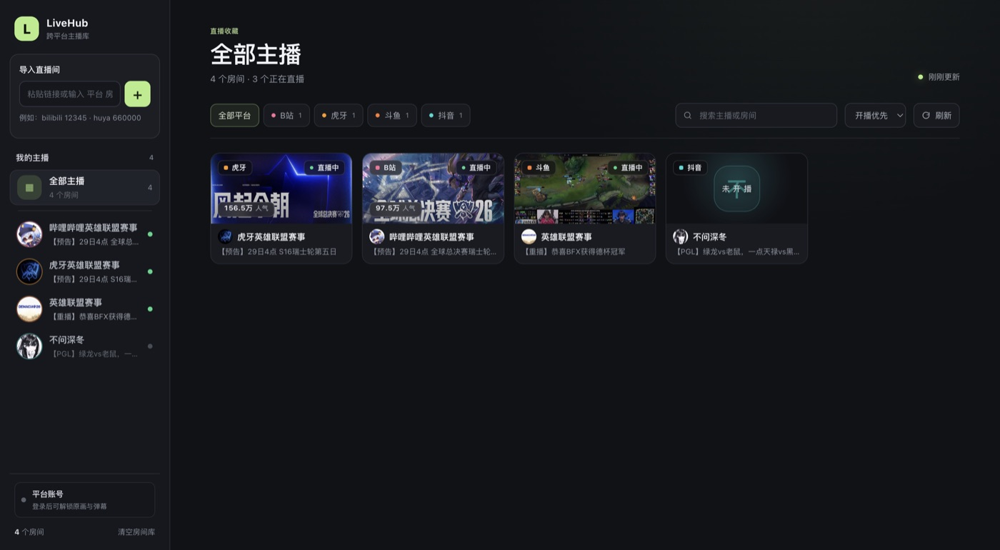
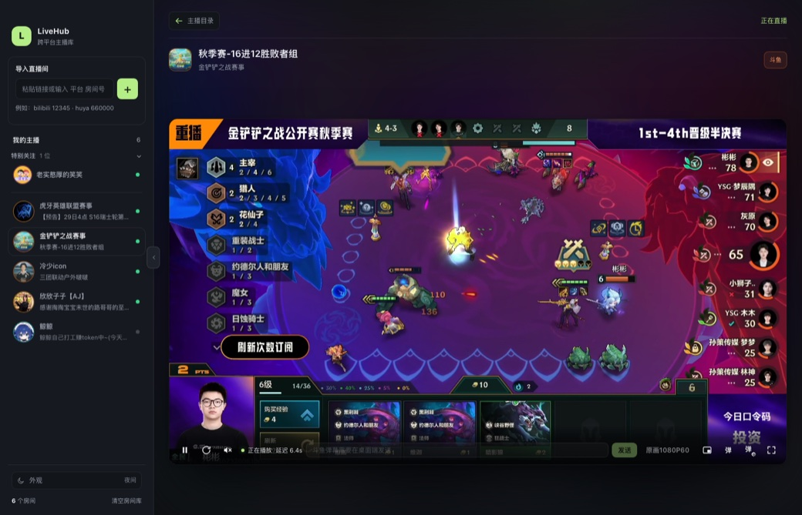

<div align="center">

<h1>LiveHub</h1>

<p><b>把四个直播平台收进一个窗口：主播库、播放器、弹幕收发，全部本地运行。</b></p>

<p>
  
  
  
  
  
</p>

<p></p>

</div>

## 这是什么

LiveHub 是一个**本地优先**的直播工作台。不用在四个网站的标签页之间来回切，也不用忍受各家播放器的广告和推荐流。

- 粘贴链接就能把直播间加进自己的**主播库**，按主播、平台、开播状态管理
- 用**自研播放器**看，清晰度和线路自己选
- **弹幕能读也能发**，四个平台统一在一个输入框里
- 所有数据留在本机，不需要注册 LiveHub 账号

> 视频流和弹幕都来自各平台官方接口，LiveHub 只是把它们整理成一个自己顺手的界面。

## 功能

| 能力 | 说明 |
| --- | --- |
| 📥 导入房间 | 粘贴直播间链接、短链，或直接输入 `平台 房间号` |
| 🗂 主播库 | 按平台筛选、搜索、按开播状态/人气/导入时间排序，本地 JSON 保存 |
| 📺 自研播放器 | HLS / HTTP-FLV 双协议，清晰度与 CDN 线路分开切换，断流自动重连 |
| 💬 弹幕读取 | 四平台全部接入，实时进侧栏，可叠加悬浮弹幕 |
| ✍️ 弹幕发送 | 四平台全部可用，带发送前校验、失败原因说明、自己发的去重 |
| 👤 平台账号 | 应用内扫码/密码登录，Cookie 只落本机 |
| 🔄 开播状态 | 目录页 3 分钟轮询，进房间未开播每 30 秒重试 |
| 🖥 平台官方页 | 需要送礼等高级互动时，可在窗口内切到官方房间页 |

## 平台支持

| 平台 | 看直播 | 读弹幕 | 发弹幕 | 读取方式 |
| :--- | :---: | :---: | :---: | :--- |
| 哔哩哔哩 | ✅ | ✅ | ✅ | 服务端直连 WSS（brotli 分包） |
| 虎牙 | ✅ | ✅ | ✅ | 服务端直连 `wsapi.huya.com` |
| 斗鱼 | ✅ | ✅ | ✅ | 服务端直连 `danmuproxy.douyu.com` |
| 抖音 | ✅ | ✅ | ✅ | 桌面端影子窗口旁路抓包（需桌面版） |

补充说明：

- **抖音的读取和发送都依赖桌面版**——它的接口要 `a_bogus` 现算签名，LiveHub 不自己造签名，而是让官方页面算，再从旁复制字节。浏览器模式只能看直播，拿不到弹幕。
- 发送策略分两种：B 站由服务端直接调接口；斗鱼 / 虎牙 / 抖音由桌面端在真实页面里「输入 + 点发送」，因为这三家的发送通道要么签名在页面里、要么会校验客户端指纹。

## 快速开始

```bash
git clone https://github.com/Linley116/LiveHub.git
cd livehub
npm install

npm run desktop    # 桌面版（推荐，弹幕/发送功能最全）
npm start          # 浏览器版 → http://127.0.0.1:7788（只能看 + 读弹幕）
```

要求：Node.js ≥ 20。开发模式在 macOS / Windows / Linux 都能跑，**目前只提供 macOS 安装包**。

上手三步：

1. 左侧输入框粘贴直播间链接（或输 `douyu 138243`）→ 回车
2. 点卡片进房间，播放器自动取流
3. 在「平台账号」里登录一次，弹幕和原画清晰度就都解锁了

打包成可分发应用：

```bash
npm run dist       # 生成安装包（macOS → dist/*.dmg）
npm run dist:dir   # 只出 .app，用于快速验证
```

## 界面

**观看页**：中间播放，右边弹幕，底下输入框。四个平台在这个页面上长得一样。

<p align="center"></p>

## 工作原理

```text
┌───────────────────────────────────────────────────────────┐
│                      Electron 主进程                        │
│                                                           │
│   ┌──────────────┐   ┌──────────────┐   ┌──────────────┐  │
│   │  内嵌 Express │   │  登录窗口      │   │  发送/影子窗口 │  │
│   │  随机端口     │   │  persist 分区  │   │  隐藏、静音    │  │
│   └──────┬───────┘   └──────┬───────┘   └──────┬───────┘  │
└──────────┼──────────────────┼──────────────────┼──────────┘
           │                  │                  │
      ┌────▼──────────────────▼──────────────────▼────┐
      │              本地服务（Node / ESM）            │
      │  resolvers  四平台取流与元数据解析              │
      │  danmaku    四平台连接器 + 连接生命周期管理       │
      │  accounts   Cookie 存储与登录判定               │
      │  store      本地房间库                         │
      └────────────────────┬─────────────────────────┘
                           │ HTTP / SSE
                    ┌──────▼──────┐
                    │  Web UI      │
                    │  原生 JS     │
                    └─────────────┘
```

三层各管一件事：

- **resolvers**：把「房间号」变成「能播的地址」。四个平台的接口、签名、清晰度参数都不一样，全部在这里抹平。
- **danmaku**：每个平台一个连接器，统一输出 `{ user, content, color, timestamp }`。同一房间多个页面只连一条上游，最后一个人走了才断。
- **Web UI**：原生 JS（没有框架），通过 SSE 接弹幕，通过 REST 管房间。

技术深水区（虎牙切片签名、斗鱼静默丢弃、抖音签名旁路、发送通道选型等）单独放在 **[docs/TECHNICAL.md](docs/TECHNICAL.md)**。

## 数据与隐私

- 房间库：`<userData>/data/rooms.json`（macOS 是 `~/Library/Application Support/livehub/data/`）
- 平台 Cookie：同目录 `accounts.json`，**只在本机**，不上传、不回传
- 服务默认只监听 `127.0.0.1`，随机端口，外部访问不到
- 删除数据：侧栏「清空房间库」，或直接删掉上面那个目录

## 常见问题

<details>
<summary><b>打开应用提示「已损坏」或「无法验证开发者」</b></summary>

安装包没有做代码签名/公证。右键 App → **打开**，或执行：

```bash
xattr -dr com.apple.quarantine /Applications/LiveHub.app
```
</details>

<details>
<summary><b>为什么要用桌面版，浏览器版不行吗？</b></summary>

四家平台的房间页都不允许被第三方站点内嵌（B 站 `X-Frame-Options`、抖音 CSP 白名单），
第三方 Cookie 限制也会让登录态失效。桌面版用 Electron 直接加载官方页面，是顶层上下文，
不受这些限制——**发弹幕、读抖音弹幕**都依赖这一点。

浏览器版仍然可以看直播、读 B 站/虎牙/斗鱼的弹幕。
</details>

<details>
<summary><b>提示「本直播间无法发言」怎么办？</b></summary>

说明这个房间设了发言门槛。LiveHub 会尽量给出具体原因（需要粉丝牌 / 等级 / 已禁言 / 仅管理员），
实在拿不到时也会明确告诉你「这个房间可能限制了发言」。

满足条件后（比如加了粉丝团），直接在输入框再点一次发送即可，不需要重启。
</details>

<details>
<summary><b>某个直播间突然黑屏 / 解析失败</b></summary>

直播平台的接口和页面结构会变。先试：切线路 → 切清晰度 → 重新进房间。
仍然不行的话，多半是该平台的解析需要更新（见 `server/resolvers/`）。
</details>

<details>
<summary><b>登录后清晰度还是没解锁</b></summary>

部分平台未登录会**降级但不报错**（B 站请求原画只回超清，斗鱼只回蓝光）。
LiveHub 会比对「请求档位 / 实际下发档位」，在播放器下方明确提示，不会假装切成功。
遇到这种情况，去「平台账号」里确认登录态还在。
</details>

## 项目结构

```text
server/
  index.js            Express 服务与本地 REST API
  resolvers/          四平台房间元数据与播放线路解析
  danmaku/            四平台弹幕连接器 + 生命周期管理
  accounts.js         平台账号（Cookie 存储、登录判定）
  store.js            本地房间库
desktop/
  main.cjs            Electron 主进程：内嵌服务、登录窗口、账号同步
  sender.cjs          弹幕发送器（在真实页面里代发）
  shadow.cjs          抖音影子窗口（旁路抓弹幕）
  preload.cjs         暴露给页面的桥
web/
  index.html          主播库与观看页
  app.js              路由、播放器、弹幕面板
  hub.css             样式
docs/
  TECHNICAL.md        技术细节与踩坑记录
```

## 免责声明

本项目仅用于个人学习和本地使用。所有直播内容、弹幕数据的版权归各平台及主播所有。
请遵守各平台的服务条款，不要用于爬取、批量分发或其他商业用途。
接口随时可能变化，不保证长期可用。

## License

[MIT](LICENSE) © Linley116

你可以自由使用、修改、分发，包括商业用途，保留版权声明即可。
